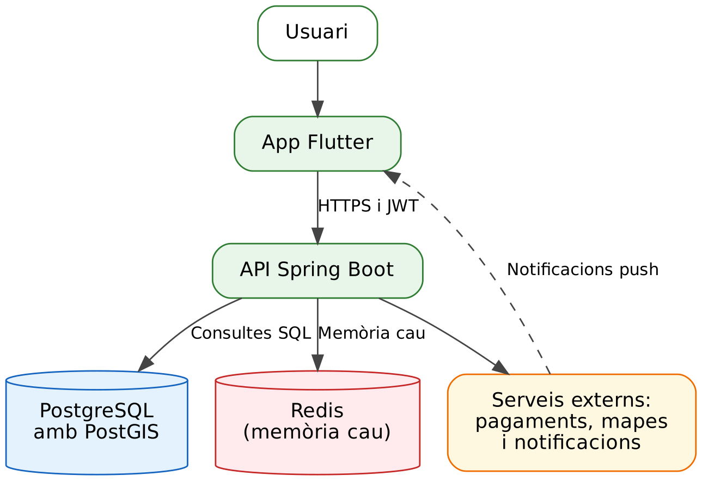

# Components tecnològics d'EcoRide

## Flutter (aplicació mòbil)

Flutter és el framework amb el qual es desenvolupa l'app que usen els ciclistes, tant per a Android com per a iOS, amb un únic codi. Dins d'EcoRide s'encarrega de:

- Mostrar el mapa amb les estacions i les bicicletes disponibles
- Escanejar el codi QR i comunicar-se amb el candado per Bluetooth o NFC
- Mostrar les rutes, el comptador de CO₂ i els punts verds de l'usuari
- Enviar les peticions a l'API i presentar-ne les respostes en pantalla
- Rebre notificacions *push* de reserves, reptes i avisos

## Spring Boot (backend)

Spring Boot, escrit en Java, és el servidor que conté la lògica de negoci i exposa l'API REST a la qual es connecta l'app. Dins d'EcoRide s'encarrega de:

- Autenticar els usuaris i validar els seus tokens (JWT)
- Gestionar reserves, viatges, tarifes i pagaments
- Calcular el CO₂ evitat i assignar els punts verds
- Consultar i actualitzar les dades de la base de dades
- Connectar-se amb serveis externs: mapes, pagaments i notificacions

## PostgreSQL (base de dades)

PostgreSQL, amb l'extensió PostGIS, és on es guarda de manera permanent tota la informació del sistema. Dins d'EcoRide s'encarrega de:

- Emmagatzemar usuaris, bicicletes, estacions, viatges i pagaments
- Guardar l'historial de punts verds i l'impacte ambiental de cada persona
- Resoldre consultes geogràfiques, com ara "estacions a menys de 500 m" gràcies a PostGIS
- Garantir la coherència de les dades mitjançant transaccions i restriccions

## Diagrama de relacions entre components

## Recorregut d'una petició

Quan un usuari prem el botó de reservar una bici, l'app Flutter construeix una petició amb les dades necessàries (la bici triada i l'identificador de l'usuari) i l'envia en format JSON a l'API per HTTPS, adjuntant el token JWT que acredita la sessió. En arribar al backend, Spring Boot la rep en un controlador, valida el token i passa les dades a la capa de servei, que aplica les regles de negoci. Primer comprova a Redis si la bici consta com a disponible i, si cal, consulta PostgreSQL mitjançant el repositori, que executa la consulta SQL i registra la reserva. Quan la base de dades confirma l'operació, el backend actualitza la memòria cau i genera una resposta JSON que torna a l'app pel mateix camí. Finalment, Flutter interpreta la resposta i actualitza la pantalla per mostrar a l'usuari que la reserva s'ha fet correctament.